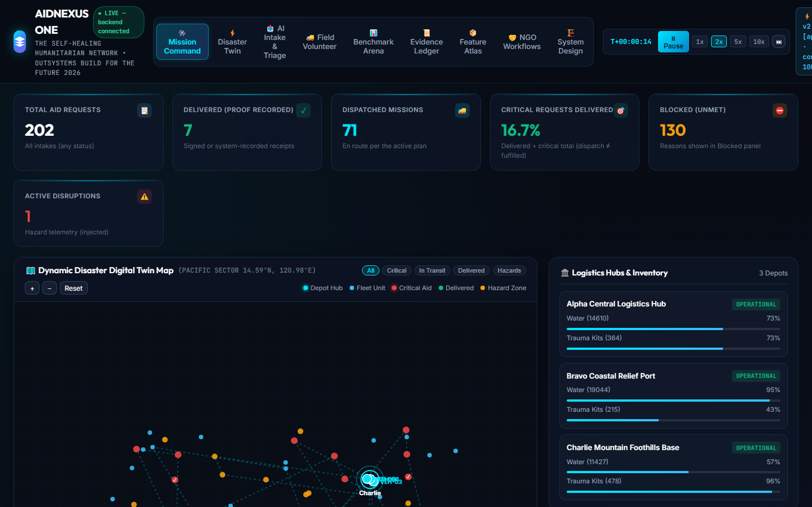

# AIDNEXUS ONE — Adaptive Crisis Outbuild Systems

> **The Self-Healing Humanitarian Network.** Evidence-driven, agentic
> mission-control for humanitarian relief — from raw distress message to
> verified, audited assistance that survives disasters mid-operation.
> OutSystems "Build for the Future" Hackathon 2026 entry.

**Verified state at submission: 256 backend tests + 11 real-browser journeys, all green** (proven from a clean clone of this repository).



## The 60-second pitch

Two NGOs, three warehouses, 200 aid requests, 10 vehicles, 12 volunteers, limited inventory. A coordinator turns unstructured distress messages into optimizer-planned, **human-approved** dispatch missions. Then a warehouse floods — and the platform **replans around it without losing completed deliveries**, asks a human to approve the new plan, and keeps an unforgeable audit trail of every decision. Five end-to-end mission capabilities are implemented and test-proven:

| # | Mission capability | Proof |
|---|---|---|
| A | Request → consent → triage → plan → approval → dispatch → idempotent delivery → evidence receipt | `tests/test_mission_a_e2e.py` |
| B | Self-healing: depot outage + route closure + vehicle breakdown → recovery plans, human approval, zero lost work, queue/plan concordance 1.0 | `tests/test_mission_b_e2e.py` |
| C | Cross-NGO resource sharing with sequential dual approval and dual-ledger atomic movement | `tests/test_mission_c_e2e.py` |
| D | Procurement: supplier verification, budget enforcement, goods receipt with discrepancy handling | `tests/test_mission_d_e2e.py` |
| E | Impact reports recomputed from receipts + ledger + audit with explicit formulas and provenance hash | `tests/test_mission_e_e2e.py` |

## What's actually implemented (honesty included)

✅ **Multi-tenant platform**: orgs, memberships, roles, revocable sessions, tenant isolation on every query (red-team suite proves forged headers fail closed).
✅ **Optimizer**: priority-weighted insertion + priority-preserving 2-opt — a *heuristic*, honestly labeled, never claimed exact; dispatch queue is a pure projection of the approved plan (concordance 1.0, P0-tested).
✅ **Agents with contracts**: triage/extraction, planning proposal, recovery interpretation — every action schema-validated with postconditions verified against real state. Deterministic provider by default; Mistral/OpenAI-compatible adapter ready (real inference BLOCKED without keys — never simulated).
✅ **Trust architecture**: beneficiary consent (required at intake, revocable, blocks delivery while revoked), duplicate detection routed to humans (never auto-denied), hash-chained tamper-evident audit, idempotent receipts/inventory/ledger keys.
✅ **System design, engineered and visualized**: token-bucket rate limiting (429 + Retry-After), circuit breaker + full-jitter retries on the provider path, transactional outbox with dead-letter queue, DB-claimed durable scheduler (UTC, duplicate-proof). Kubernetes/Kafka/Redis/2PC **explicitly rejected with rationale** — see the decision matrix.
✅ **System Design Studio** (in-app): all 20 foundational system-design topics mapped to THIS codebase with honest status chips, live failure lab (real 429 / scheduler / idempotency runs), request trace, light/dark themes.
❌ **Honestly BLOCKED** (no credentials exist in this environment): OutSystems ODC access, live LLM keys, OIDC identity provider, PostgreSQL server, notification providers. Interfaces are prepared and labeled — nothing is faked.

## Quick start (60 seconds)

```bash
cd backend
pip install -r requirements.txt
python -m uvicorn app.main:app --host 127.0.0.1 --port 8000
# open http://127.0.0.1:8000/ → log in as the coordinator identity
```

Windows 1-click: `start.bat` (repo root's parent folder) or `start.ps1`.

## Verify everything yourself

```bash
cd backend
python -m pytest                          # 256 tests (~60 s, temp DB)
python -m pytest tests/browser -m browser # 11 real Chromium journeys
python scripts/validate_feature_atlas.py  # ATLAS VALID
python -m app.benchmark                    # reproducible optimizer benchmarks
```

## The 5-minute demo

Follow `docs/phase-4/DEMO_RUNBOOK.md`: mission command → AI intake with consent → depot failure → human-approved recovery → volunteer signature delivery → cross-NGO transfer → evidence-linked impact report with provenance hash. One-click scenario reset; simulated records always labeled.

## Explore

- **8 in-app workspaces**: Mission Command, Disaster Twin, AI Intake & Triage, Field Volunteer, Benchmark Arena, Evidence Ledger, Feature Atlas (1,080-feature live portfolio), NGO Workflows, System Design Studio.
- **Docs by phase**: `docs/phase-2` (production readiness + browser/load evidence), `docs/product` (the 1,080-feature atlas + validator), `docs/phase-4` (five mission capabilities + security red-team + benchmarks), `docs/system-design` (20-topic decision matrix + failure lab).

## AI-assistance disclosure

This project was built with the help of Mistral Vibe (AI coding agent) under the direction of the repository owner, following the competition's AI policy. All engineering claims in this README and the docs are backed by executable tests committed in this repository — the suite above is the proof.
