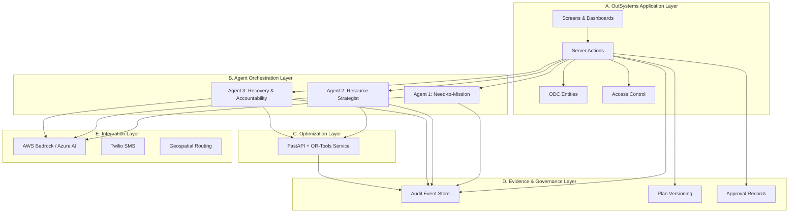

# System Architecture — AIDNEXUS ONE

## 1. Architecture Overview

AIDNEXUS ONE is a layered humanitarian mission-control system with five principal layers:



## 2. Layer Details

### A. OutSystems Application Layer

The authoritative business application runs on OutSystems Developer Cloud (ODC).

**Screens:**

| Screen | Purpose | Priority |
|--------|---------|----------|
| Mission Command | Operational dashboard with KPIs, active missions, pending approvals | P0 |
| Aid Request Intake | Form for submitting new humanitarian requests | P0 |
| Warehouse Management | Depot and inventory CRUD | P0 |
| Human Approval Center | Review and approve/reject mission plans | P0 |
| Delivery Confirmation | Field volunteer delivery workflow | P0 |
| Disaster Digital Twin | Scenario simulation with failure injection | P1 |
| Agent Mission Control | Agent trace viewer with evidence | P1 |
| Proof of Impact | Impact metrics and benchmark results | P2 |
| Field Operations | Mobile-friendly volunteer assignment view | P2 |

**Server Actions (key):**

| Action | Responsibility |
|--------|---------------|
| CreateAidRequest | Validate and persist new request |
| TransitionMissionState | Enforce state machine with preconditions |
| InvokeOptimizer | Call external optimization service |
| ApproveMissionPlan | Validate authority, record approval, trigger dispatch |
| RecordDelivery | Mark assignment delivered, adjust inventory |
| TriggerDisruption | Inject warehouse/route failure for simulation |
| ResetScenario | Restore deterministic initial state |

**Data Model:**
Normalized entities in ODC (see domain-model.md for full ER diagram).

**Access Control:**
ODC native roles: NGO_ADMIN, MISSION_COORDINATOR, FIELD_VOLUNTEER, AUDITOR, READ_ONLY_OBSERVER.

### B. Agent Orchestration Layer

Three principal agents coordinate through the OutSystems Agent Experience framework (or direct LLM API calls if Agent Experience is not available for ODC).

#### Agent 1: Need-to-Mission

```
TRIGGER: New AidRequest created
INPUT:   Raw request text, requester metadata, existing requests
OUTPUT:  Structured work order (AidRequestItems), duplicate flag, confidence score

TOOLS AVAILABLE:
  - ExtractAidItems: Parse text → structured items with quantities
  - CheckDuplicates: Compare against recent requests by location/content
  - ClassifyUrgency: Assign priority level (CRITICAL, HIGH, MEDIUM, LOW)
  - FlagForReview: Route uncertain cases to human queue

GUARDRAILS:
  - Never auto-approve medical requests
  - Never fabricate item quantities not in source text
  - Confidence < 0.7 → automatic human review flag
  - All outputs include source reference to original text
```

#### Agent 2: Resource Strategist

```
TRIGGER: Verified requests ready for planning, OR replanning requested
INPUT:   Verified requests, depot inventory, vehicle fleet, volunteer pool, route distances
OUTPUT:  Proposed MissionPlan with assignments, unmet demand, tradeoff explanation

TOOLS AVAILABLE:
  - GetInventory: Read current warehouse stock levels
  - GetAvailableVehicles: Read vehicle fleet with capacities
  - GetAvailableVolunteers: Read volunteer availability windows
  - GetRouteDistances: Read travel distance matrix
  - InvokeOptimizer: Call OR-Tools optimization service
  - ComparePlans: Diff two plan versions
  - ExplainTradeoffs: Generate human-readable explanation of allocation decisions

GUARDRAILS:
  - Never use LLM-generated inventory counts as ground truth
  - Always validate optimizer output against constraints
  - Preserve existing valid assignments during replanning
  - Report unmet demand explicitly — never silently drop requests
```

#### Agent 3: Recovery & Accountability

```
TRIGGER: Disruption event detected (warehouse failure, route closure, etc.)
INPUT:   Disruption details, current active plan, delivery status
OUTPUT:  Recovery plan proposal, impact assessment, human review request

TOOLS AVAILABLE:
  - AssessDisruptionImpact: Identify affected assignments
  - GetCompletedDeliveries: List deliveries already finished (immutable)
  - GetValidAssignments: List unaffected assignments to preserve
  - RequestReplanning: Trigger Agent 2 with updated constraints
  - GenerateRecoveryExplanation: Create human-readable disruption narrative
  - CreateApprovalRequest: Submit recovery plan for coordinator review

GUARDRAILS:
  - Completed deliveries are NEVER modified
  - Recovery plan requires human approval before application
  - Double-dispatch prevention via optimistic concurrency
  - All disruption events logged to audit trail
```

### C. Optimization Layer

**Technology**: Python 3.11 + FastAPI + Google OR-Tools

**Service Contract**:

```
POST /api/v1/optimize

Request Body:
{
  "requests": [...],           // Aid requests with items, quantities, priority, location
  "depots": [...],             // Warehouses with inventory levels
  "vehicles": [...],           // Vehicles with capacity, availability, base depot
  "volunteers": [...],         // Volunteers with availability windows
  "distances": {...},          // Distance matrix between locations
  "blocked_routes": [...],     // Currently blocked route segments
  "existing_commitments": [...], // Assignments to preserve (for replanning)
  "config": {
    "max_solve_time_seconds": 30,
    "objective_weights": {...},
    "scenario_seed": 42
  }
}

Response Body:
{
  "status": "OPTIMAL" | "FEASIBLE" | "INFEASIBLE" | "ERROR",
  "assignments": [...],        // Vehicle → depot → request assignments
  "unmet_demand": [...],       // Requests that couldn't be fulfilled
  "metrics": {
    "total_distance": 1234.5,
    "fulfilled_requests": 180,
    "critical_fulfilled": 45,
    "deadline_violations": 2,
    "resource_utilization": 0.87,
    "vehicle_capacity_violations": 0,
    "inventory_violations": 0
  },
  "solver_info": {
    "objective_value": 98765.4,
    "solve_time_seconds": 3.2,
    "gap": 0.01,
    "iterations": 15000
  },
  "explanation": {
    "objective_breakdown": {...},
    "binding_constraints": [...],
    "tradeoff_summary": "..."
  }
}
```

**Optimization Formulation (Pseudocode)**:

```
OBJECTIVE: Minimize weighted sum of:
  - w1 * unmet_critical_demand          (highest weight)
  - w2 * unmet_standard_demand
  - w3 * total_travel_distance
  - w4 * deadline_violations
  - w5 * (1 - resource_utilization)

HARD CONSTRAINTS:
  C1: Vehicle capacity not exceeded
  C2: Inventory not over-allocated (per depot, per item)
  C3: Volunteer availability windows respected
  C4: Blocked routes not traversed
  C5: Existing completed deliveries preserved
  C6: Each request assigned at most once
  C7: Vehicle starts and ends at its base depot

SOFT CONSTRAINTS (penalized in objective):
  S1: Delivery deadline preferences
  S2: Equitable distribution across regions
  S3: Minimize volunteer overtime
```

### D. Evidence & Governance Layer

**Audit Events** — Append-only records for every consequential action:

```
AuditEvent {
  Id: GUID
  Timestamp: DateTime (UTC)
  EventType: ENUM (REQUEST_CREATED, STATE_TRANSITION, PLAN_CREATED, 
                    APPROVAL_GRANTED, DISPATCH_STARTED, DELIVERY_CONFIRMED,
                    DISRUPTION_DETECTED, REPLAN_REQUESTED, REPLAN_APPROVED, ...)
  ActorId: GUID (user or agent)
  ActorType: ENUM (HUMAN, AGENT, SYSTEM)
  EntityType: STRING
  EntityId: GUID
  PreviousState: STRING (nullable)
  NewState: STRING (nullable)
  Details: JSON
  SourceReference: STRING
  OrganizationId: GUID (tenant isolation)
}
```

**Plan Versioning**: Each optimization run creates a new `MissionPlanVersion`. Plans are never mutated in place.

**Approval Records**: Every approval/rejection is a separate, immutable record linked to the plan version and the approving user.

### E. Integration Layer

| Integration | Purpose | Implementation |
|-------------|---------|---------------|
| AWS Bedrock | LLM for agent reasoning | REST API via ODC integration |
| Azure AI | Alternative LLM provider | REST API (failover) |
| OR-Tools Service | Mathematical optimization | REST API on separate host |
| Twilio | SMS notifications to volunteers | REST API via ODC integration |

**Fallback Strategy**: If LLM provider is unavailable, the system falls back to rule-based request processing (regex-based item extraction, manual priority assignment) with a visible "AI Unavailable" indicator.

## 3. Deployment Architecture

```
┌─────────────────────────┐     ┌─────────────────────────┐
│   OutSystems Cloud      │     │   External Host          │
│                         │     │   (Azure/AWS/Railway)    │
│   ODC Application       │────▶│   FastAPI Optimizer      │
│   - Screens             │     │   - OR-Tools solver      │
│   - Server Actions      │     │   - Benchmark runner     │
│   - Entities            │     │                         │
│   - Agent Experience    │     └─────────────────────────┘
│                         │
│           │              │     ┌─────────────────────────┐
│           ▼              │     │   Cloud AI Provider     │
│   REST Integrations ─────│────▶│   AWS Bedrock           │
│                         │     │   or Azure OpenAI       │
└─────────────────────────┘     └─────────────────────────┘
```

## 4. Data Flow: Primary Workflow

```mermaid
sequenceDiagram
    participant User as Coordinator
    participant OS as OutSystems App
    participant A1 as Agent 1
    participant A2 as Agent 2
    participant OPT as Optimizer
    participant LLM as LLM Provider
    participant DB as ODC Entities

    User->>OS: Submit aid request
    OS->>DB: Save AidRequest (REQUESTED)
    OS->>A1: Interpret request
    A1->>LLM: Extract items, classify urgency
    A1->>DB: Save AidRequestItems
    A1->>DB: Transition to UNDER_REVIEW / VERIFIED

    User->>OS: Trigger planning
    OS->>A2: Create mission plan
    A2->>DB: Read inventory, vehicles, volunteers
    A2->>OPT: POST /optimize with all constraints
    OPT-->>A2: Optimal assignments + metrics
    A2->>LLM: Generate tradeoff explanation
    A2->>DB: Save MissionPlanVersion (PENDING_APPROVAL)

    User->>OS: Review plan
    User->>OS: Approve plan
    OS->>DB: Record Approval
    OS->>DB: Transition to APPROVED → DISPATCHED
    OS->>DB: Create MissionAssignments

    User->>OS: Volunteer confirms delivery
    OS->>DB: Record DeliveryReceipt
    OS->>DB: Transition to DELIVERED
    OS->>DB: Adjust inventory
```

## 5. Data Flow: Disruption Recovery

```mermaid
sequenceDiagram
    participant Sys as System/Coordinator
    participant OS as OutSystems App
    participant A3 as Agent 3
    participant A2 as Agent 2
    participant OPT as Optimizer
    participant DB as ODC Entities
    participant User as Coordinator

    Sys->>OS: Report warehouse failure
    OS->>DB: Create Disruption record
    OS->>A3: Assess disruption impact

    A3->>DB: Get affected assignments
    A3->>DB: Get completed deliveries (preserve)
    A3->>DB: Get valid unaffected assignments

    A3->>A2: Request replanning
    A2->>OPT: POST /optimize (updated constraints)
    OPT-->>A2: New assignments

    A2->>A3: Return new plan
    A3->>DB: Save new MissionPlanVersion
    A3->>DB: Generate plan comparison

    A3->>User: Present recovery plan for approval
    User->>OS: Review diff, approve
    OS->>DB: Record approval
    OS->>DB: Apply new assignments (exactly once)
    OS->>DB: Log audit events
```
