# Domain Model — AIDNEXUS ONE

## Entity Relationship Diagram

```mermaid
erDiagram
    Organization ||--o{ OrganizationMember : has
    Organization ||--o{ Depot : owns
    Organization ||--o{ Vehicle : owns
    Organization ||--o{ Volunteer : manages
    Organization ||--o{ Mission : creates
    Organization ||--o{ AuditEvent : generates

    OrganizationMember {
        GUID Id PK
        GUID OrganizationId FK
        GUID UserId FK
        ENUM Role "NGO_ADMIN | MISSION_COORDINATOR | FIELD_VOLUNTEER | AUDITOR | READ_ONLY_OBSERVER"
        BOOLEAN IsActive
        DATETIME CreatedAt
        DATETIME UpdatedAt
    }

    Organization {
        GUID Id PK
        STRING Name
        STRING Description
        STRING ContactEmail
        STRING Region
        BOOLEAN IsActive
        DATETIME CreatedAt
        DATETIME UpdatedAt
    }

    BeneficiaryReference ||--o{ AidRequest : submits
    BeneficiaryReference {
        GUID Id PK
        GUID OrganizationId FK
        STRING ReferenceCode "Synthetic identifier — NOT real PII"
        STRING Region
        STRING HouseholdSize
        BOOLEAN IsSynthetic "Always TRUE in demo"
        DATETIME CreatedAt
    }

    AidRequest ||--o{ AidRequestItem : contains
    AidRequest {
        GUID Id PK
        GUID OrganizationId FK
        GUID BeneficiaryReferenceId FK
        STRING RawText "Original request text"
        ENUM Status "See state machine"
        ENUM Priority "CRITICAL | HIGH | MEDIUM | LOW"
        DECIMAL Latitude
        DECIMAL Longitude
        STRING Region
        DATETIME RequestedDeadline
        BOOLEAN IsDuplicate
        GUID DuplicateOfId FK "nullable"
        DECIMAL AgentConfidence "0.0 - 1.0"
        BOOLEAN RequiresHumanReview
        STRING ScenarioId "nullable — for simulation"
        DATETIME CreatedAt
        DATETIME UpdatedAt
        INTEGER Version "optimistic concurrency"
    }

    AidRequestItem {
        GUID Id PK
        GUID AidRequestId FK
        STRING ItemCategory "FOOD | WATER | MEDICINE | SHELTER | HYGIENE | BLANKETS"
        STRING ItemName
        INTEGER QuantityRequested
        INTEGER QuantityAllocated "updated by optimizer"
        INTEGER QuantityDelivered "updated on delivery confirmation"
        DATETIME CreatedAt
        DATETIME UpdatedAt
    }

    Depot ||--o{ InventoryItem : stocks
    Depot ||--o{ InventoryMovement : records
    Depot {
        GUID Id PK
        GUID OrganizationId FK
        STRING Name
        STRING Address
        DECIMAL Latitude
        DECIMAL Longitude
        BOOLEAN IsOperational "FALSE when disrupted"
        STRING DisruptionReason "nullable"
        INTEGER MaxCapacityUnits
        DATETIME CreatedAt
        DATETIME UpdatedAt
    }

    InventoryItem {
        GUID Id PK
        GUID DepotId FK
        STRING ItemCategory
        STRING ItemName
        INTEGER QuantityAvailable
        INTEGER QuantityReserved "allocated but not yet dispatched"
        INTEGER QuantityMinimum "safety stock threshold"
        DATETIME LastRestockDate
        DATETIME CreatedAt
        DATETIME UpdatedAt
        INTEGER Version "optimistic concurrency"
    }

    InventoryMovement {
        GUID Id PK
        GUID DepotId FK
        GUID InventoryItemId FK
        ENUM MovementType "RESTOCK | ALLOCATION | DISPATCH | RETURN | ADJUSTMENT"
        INTEGER Quantity "positive for inflow, negative for outflow"
        GUID ReferenceId "mission assignment or restock order"
        STRING Reason
        GUID ActorId
        DATETIME CreatedAt
    }

    Vehicle {
        GUID Id PK
        GUID OrganizationId FK
        GUID BaseDepotId FK
        STRING Name
        INTEGER CapacityUnits
        BOOLEAN IsAvailable
        STRING UnavailableReason "nullable"
        DATETIME CreatedAt
        DATETIME UpdatedAt
    }

    Volunteer ||--o{ VolunteerAvailability : has
    Volunteer {
        GUID Id PK
        GUID OrganizationId FK
        GUID UserId FK "nullable"
        STRING Name
        STRING Phone
        STRING Region
        BOOLEAN IsActive
        DATETIME CreatedAt
        DATETIME UpdatedAt
    }

    VolunteerAvailability {
        GUID Id PK
        GUID VolunteerId FK
        DATE AvailableDate
        DATETIME StartTime
        DATETIME EndTime
        BOOLEAN IsConfirmed
        DATETIME CreatedAt
    }

    Mission ||--o{ MissionPlanVersion : has
    Mission ||--o{ MissionAssignment : contains
    Mission ||--o{ Dispatch : generates
    Mission {
        GUID Id PK
        GUID OrganizationId FK
        STRING Name
        STRING Description
        ENUM Status "See state machine"
        ENUM MissionType "FLOOD_RESPONSE | EARTHQUAKE | DISPLACEMENT | GENERAL"
        DATETIME PlannedStartDate
        DATETIME PlannedEndDate
        GUID CurrentPlanVersionId FK "nullable"
        STRING ScenarioId "nullable — for simulation"
        DATETIME CreatedAt
        DATETIME UpdatedAt
        INTEGER Version "optimistic concurrency"
    }

    MissionPlanVersion {
        GUID Id PK
        GUID MissionId FK
        INTEGER VersionNumber
        ENUM PlanType "INITIAL | REPLAN"
        GUID OptimizationRunId FK
        GUID PreviousVersionId FK "nullable"
        STRING ChangeReason "nullable — e.g., Warehouse B failure"
        ENUM Status "DRAFT | PENDING_APPROVAL | APPROVED | REJECTED | SUPERSEDED"
        JSON PlanData "serialized assignment details"
        JSON MetricsSummary "fulfillment %, distance, etc."
        JSON DiffFromPrevious "nullable — changes from prior version"
        DATETIME CreatedAt
    }

    MissionAssignment {
        GUID Id PK
        GUID MissionId FK
        GUID MissionPlanVersionId FK
        GUID AidRequestId FK
        GUID DepotId FK
        GUID VehicleId FK
        GUID VolunteerId FK "nullable"
        ENUM Status "PLANNED | DISPATCHED | IN_TRANSIT | DELIVERED | CANCELLED | BLOCKED"
        INTEGER AllocatedUnits
        DECIMAL EstimatedDistanceKm
        DATETIME EstimatedArrival
        DATETIME ActualArrival "nullable"
        BOOLEAN IsPreservedFromPriorPlan "TRUE if carried over during replan"
        DATETIME CreatedAt
        DATETIME UpdatedAt
        INTEGER Version "optimistic concurrency"
    }

    OptimizationRun {
        GUID Id PK
        GUID MissionId FK
        ENUM RunType "INITIAL | REPLAN | BENCHMARK"
        ENUM SolverStatus "OPTIMAL | FEASIBLE | INFEASIBLE | TIMEOUT | ERROR"
        DECIMAL ObjectiveValue
        DECIMAL SolveTimeSeconds
        DECIMAL Gap
        INTEGER Iterations
        JSON InputSummary "request count, depot count, etc."
        JSON OutputSummary "fulfilled, unmet, distance, etc."
        JSON ConstraintReport "binding constraints, violations"
        STRING ScenarioSeed "for reproducibility"
        DATETIME CreatedAt
    }

    Approval {
        GUID Id PK
        GUID MissionPlanVersionId FK
        GUID ApproverId FK
        ENUM Decision "APPROVED | REJECTED | REQUESTED_CHANGES"
        STRING Reason "nullable"
        DATETIME CreatedAt
    }

    Dispatch {
        GUID Id PK
        GUID MissionId FK
        GUID MissionAssignmentId FK
        ENUM Status "PENDING | ACTIVE | COMPLETED | CANCELLED"
        DATETIME DispatchedAt
        DATETIME CompletedAt "nullable"
        GUID DispatchedById FK
        DATETIME CreatedAt
    }

    DeliveryReceipt {
        GUID Id PK
        GUID MissionAssignmentId FK
        GUID ConfirmedById FK
        ENUM ConfirmationType "FULL | PARTIAL | REJECTED_BY_RECIPIENT"
        INTEGER UnitsDelivered
        STRING Notes "nullable"
        STRING PhotoReference "nullable — file reference"
        DECIMAL RecipientLatitude "nullable"
        DECIMAL RecipientLongitude "nullable"
        DATETIME ConfirmedAt
        DATETIME CreatedAt
    }

    Disruption {
        GUID Id PK
        GUID OrganizationId FK
        ENUM DisruptionType "WAREHOUSE_FAILURE | ROUTE_CLOSURE | VEHICLE_BREAKDOWN | VOLUNTEER_CANCELLATION | INVENTORY_MISMATCH | DEMAND_SURGE"
        GUID AffectedEntityId "depot, route, vehicle, or volunteer ID"
        STRING AffectedEntityType
        STRING Description
        ENUM Severity "CRITICAL | HIGH | MEDIUM | LOW"
        BOOLEAN IsResolved
        DATETIME DetectedAt
        DATETIME ResolvedAt "nullable"
        GUID DetectedById FK
        DATETIME CreatedAt
    }

    AgentRun ||--o{ AgentToolCall : contains
    AgentRun {
        GUID Id PK
        ENUM AgentType "NEED_TO_MISSION | RESOURCE_STRATEGIST | RECOVERY_ACCOUNTABILITY"
        GUID TriggerId FK "request, mission, or disruption"
        STRING TriggerType
        ENUM Status "RUNNING | COMPLETED | FAILED | TIMED_OUT"
        DATETIME StartedAt
        DATETIME CompletedAt "nullable"
        STRING ModelProvider "aws_bedrock | azure_openai"
        STRING ModelId
        INTEGER TotalTokensUsed
        JSON FinalOutput "nullable"
        STRING ErrorMessage "nullable"
        DATETIME CreatedAt
    }

    AgentToolCall {
        GUID Id PK
        GUID AgentRunId FK
        STRING ToolName
        JSON InputParameters
        JSON OutputResult
        ENUM Status "SUCCESS | FAILURE | DENIED"
        STRING DenialReason "nullable — policy violation"
        DECIMAL DurationMs
        INTEGER SequenceNumber
        DATETIME CreatedAt
    }

    Incident {
        GUID Id PK
        GUID OrganizationId FK
        STRING Title
        STRING Description
        ENUM Severity "CRITICAL | HIGH | MEDIUM | LOW"
        ENUM Status "OPEN | INVESTIGATING | MITIGATED | RESOLVED | CLOSED"
        GUID MissionId FK "nullable"
        GUID DisruptionId FK "nullable"
        DATETIME CreatedAt
        DATETIME ResolvedAt "nullable"
    }

    AuditEvent {
        GUID Id PK
        GUID OrganizationId FK
        DATETIME Timestamp
        ENUM EventType "REQUEST_CREATED | STATE_TRANSITION | PLAN_CREATED | APPROVAL_GRANTED | APPROVAL_REJECTED | DISPATCH_STARTED | DELIVERY_CONFIRMED | DISRUPTION_DETECTED | REPLAN_INITIATED | REPLAN_APPROVED | INVENTORY_ADJUSTED | AGENT_INVOKED | TOOL_CALLED | SCENARIO_RESET"
        GUID ActorId
        ENUM ActorType "HUMAN | AGENT | SYSTEM"
        STRING EntityType
        GUID EntityId
        STRING PreviousState "nullable"
        STRING NewState "nullable"
        JSON Details
        STRING SourceReference
        DATETIME CreatedAt
    }

    Scenario {
        GUID Id PK
        STRING Name
        STRING Description
        STRING Seed "deterministic random seed"
        INTEGER RequestCount
        INTEGER DepotCount
        INTEGER VehicleCount
        INTEGER VolunteerCount
        JSON Configuration "scenario parameters"
        BOOLEAN IsActive
        DATETIME CreatedAt
    }

    BenchmarkRun {
        GUID Id PK
        GUID ScenarioId FK
        ENUM Mode "FIFO | NEAREST_GREEDY | STATIC_OPT | AIDNEXUS"
        STRING Seed
        JSON Metrics "all measured outcomes"
        DECIMAL SolveTimeSeconds
        DATETIME CreatedAt
    }

    Route {
        GUID Id PK
        GUID OrganizationId FK
        STRING FromLocationId
        STRING ToLocationId
        DECIMAL DistanceKm
        DECIMAL EstimatedTimeMinutes
        BOOLEAN IsBlocked
        STRING BlockedReason "nullable"
        DATETIME CreatedAt
        DATETIME UpdatedAt
    }
```

## Entity Count Summary

| Entity | Count | Purpose |
|--------|-------|---------|
| Core operational | 16 | Aid requests, depots, missions, assignments |
| Agent/AI | 2 | Agent runs, tool calls |
| Governance | 3 | Audit events, approvals, delivery receipts |
| Simulation | 2 | Scenarios, benchmark runs |
| Infrastructure | 4 | Organizations, members, routes, disruptions |
| **Total** | **27** | |

## Data Isolation

- All entities include `OrganizationId` for multi-tenant isolation
- BeneficiaryReference uses synthetic reference codes, never real PII
- AuditEvents are append-only — no UPDATE or DELETE operations
- Scenario data is tagged with `ScenarioId` and `IsSynthetic` flags
- InventoryMovements create an audit trail for every stock change
