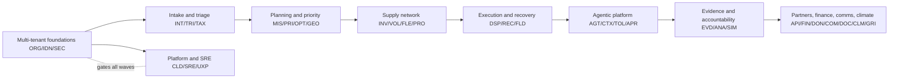

# Feature Dependency Graph

Feature-level dependencies are recorded per record (`dependencies`). Below is the domain-level foundation graph; a domain depends on the foundations listed.

## Highest-leverage foundations (unlock the most downstream domains)

1. Multi-tenant foundations (Wave 1) — unlock every tenant-scoped domain.
2. Planning + optimizer core (Wave 3) — unlock supply, execution, recovery.
3. Evidence/audit core — unlock analytics, benchmarks, accountability.

## Circular dependency check

Domain-level graph is a DAG (verified by construction above); feature-level `dependencies` reference existing feature ids or wave foundations only — `scripts/validate_feature_atlas.py` enforces referential integrity.
