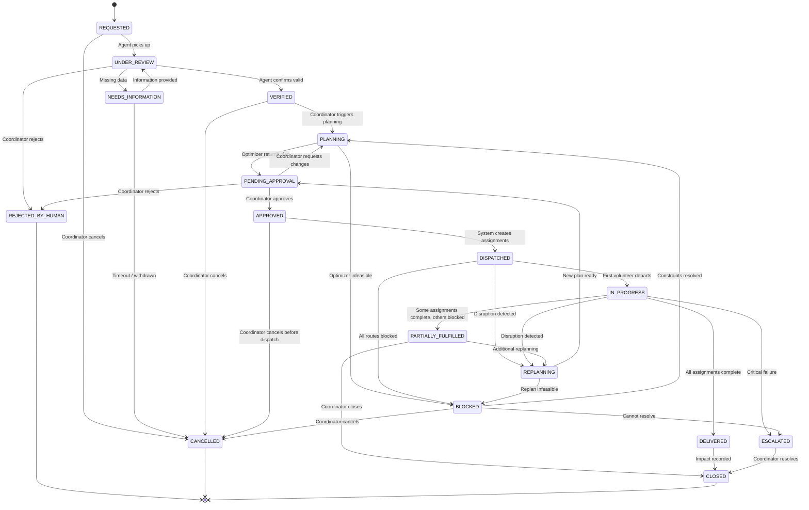

# Mission State Machine — AIDNEXUS ONE

## State Diagram

## State Definitions

| State | Description | Who Can Enter |
|-------|-------------|--------------|
| REQUESTED | New request received, not yet processed | System (on intake) |
| UNDER_REVIEW | Agent is interpreting and verifying | Agent 1 |
| NEEDS_INFORMATION | Missing data, waiting for input | Agent 1 |
| VERIFIED | Request validated, ready for planning | Agent 1 / Coordinator |
| PLANNING | Optimization in progress | Agent 2 / Coordinator |
| PENDING_APPROVAL | Plan ready for human review | Agent 2 |
| APPROVED | Plan authorized by coordinator | Coordinator |
| DISPATCHED | Assignments created and active | System |
| IN_PROGRESS | At least one delivery underway | System |
| DELIVERED | All assignments completed | System |
| PARTIALLY_FULFILLED | Some deliveries complete, others cannot proceed | System |
| BLOCKED | Cannot proceed — infeasible or infrastructure failure | System / Agent 3 |
| REPLANNING | Disruption detected, replanning underway | Agent 3 |
| ESCALATED | Critical issue requiring senior intervention | Agent 3 / Coordinator |
| REJECTED_BY_HUMAN | Coordinator rejected request or plan | Coordinator |
| CANCELLED | Request withdrawn or mission cancelled | Coordinator |
| CLOSED | Mission complete, impact recorded | Coordinator |

## Transition Rules

| From | To | Preconditions | Side Effects | Authorized Roles |
|------|----|---------------|--------------|-----------------|
| REQUESTED → UNDER_REVIEW | Agent available | Create AgentRun record | SYSTEM |
| UNDER_REVIEW → VERIFIED | All required items extracted, confidence ≥ threshold | Create AidRequestItems | AGENT, COORDINATOR |
| UNDER_REVIEW → NEEDS_INFORMATION | Missing required fields | Notify coordinator | AGENT |
| VERIFIED → PLANNING | At least one verified request | Invoke optimizer | COORDINATOR |
| PLANNING → PENDING_APPROVAL | Optimizer returns OPTIMAL or FEASIBLE | Save MissionPlanVersion | AGENT |
| PLANNING → BLOCKED | Optimizer returns INFEASIBLE | Log infeasibility reason | SYSTEM |
| PENDING_APPROVAL → APPROVED | Plan reviewed | Record Approval | COORDINATOR, NGO_ADMIN |
| APPROVED → DISPATCHED | All assignments have volunteers | Create Dispatch records | SYSTEM |
| DISPATCHED → REPLANNING | Disruption detected | Create Disruption record, invoke Agent 3 | SYSTEM, COORDINATOR |
| REPLANNING → PENDING_APPROVAL | New plan generated | Save new MissionPlanVersion with diff | AGENT |
| IN_PROGRESS → DELIVERED | All assignments status = DELIVERED | Generate impact report | SYSTEM |
| * → CANCELLED | N/A | Release reserved inventory | COORDINATOR, NGO_ADMIN |

## Invariants

1. **Completed deliveries are immutable**: Once a DeliveryReceipt exists with FULL or PARTIAL confirmation, the assignment cannot be CANCELLED or modified.
2. **No duplicate dispatches**: A DISPATCHED mission cannot re-enter DISPATCHED without going through REPLANNING → PENDING_APPROVAL → APPROVED first.
3. **Concurrency control**: State transitions use optimistic locking (Version field). Concurrent attempts to transition the same entity will fail-fast.
4. **Audit completeness**: Every transition creates an AuditEvent. No transition is valid without logging.
5. **Authorization enforcement**: Transitions are checked server-side, not just in the UI. Invalid actor roles are rejected.

## Compensation Actions

| Failed Transition | Compensation |
|-------------------|-------------|
| APPROVED → DISPATCHED fails (volunteer unavailable) | Revert to PENDING_APPROVAL, log reason |
| DISPATCHED but inventory insufficient | Create InventoryMovement reversal, transition to BLOCKED |
| REPLANNING timeout | Transition to ESCALATED, notify coordinator |
| Agent fails during UNDER_REVIEW | Transition to NEEDS_INFORMATION with manual review flag |

## Retry Behavior

| Scenario | Retry Policy |
|----------|-------------|
| Optimizer timeout | Retry once with doubled time limit, then BLOCKED |
| LLM provider error | Retry twice with exponential backoff, then manual fallback |
| Network error to external service | Retry 3 times with 1s/2s/4s backoff |
| Optimistic concurrency conflict | Reload entity, re-evaluate preconditions, retry once |
